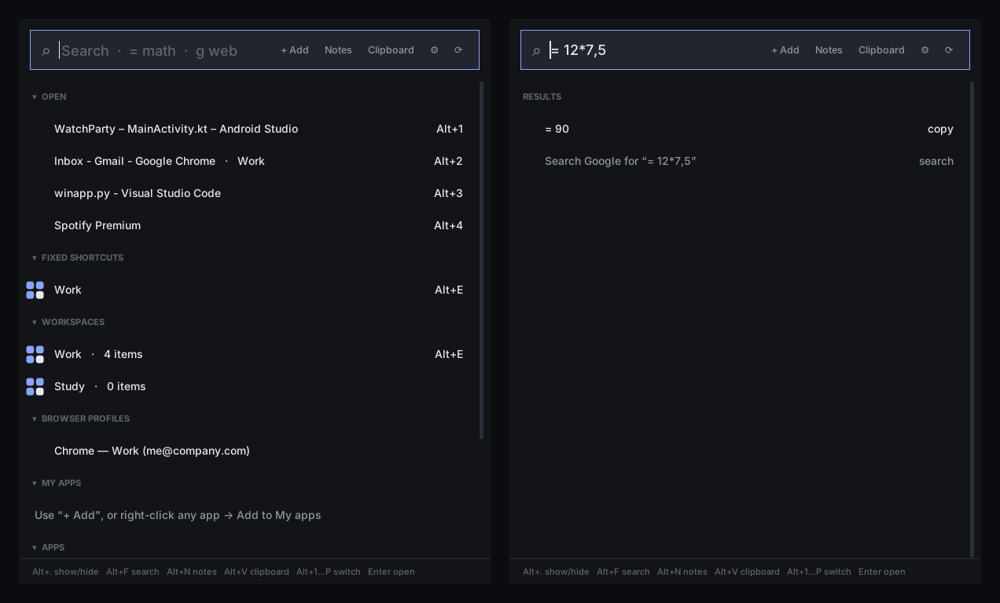

# Window Manager — keyboard launcher & window switcher for Windows

A small, fast launcher for Windows 10/11 written in Python (Tkinter + Win32 via `ctypes`).
Switch between open windows with one key, give your favourite apps and browser profiles
their own permanent shortcut, open whole workspaces at once, keep an encrypted clipboard history
and encrypted notes, expand text snippets, set timers and reminders, reopen your apps after a restart,
calculate and search the web from the search bar — all from the keyboard.



## Features

- **Window switcher** — every open window gets a shortcut: `Alt+1 … Alt+0`, then `Alt+Q … Alt+P`
  (configurable). Press it again on the active window to minimize it. `Alt+Plus` / `Alt+Minus` go
  to the next / previous window, `Alt+Space` shows a numbered list of your windows — `Space` /
  arrows to move, `Enter` to switch — and `Alt+Enter` really switches to each
  window in turn, with a transition (fade, wipe, zoom or highlight), until you press `Enter`
  (`Esc` goes back).
- **Window actions** — `Alt+Shift+T` keeps the active window **always on top**, `Alt+Shift+O` makes it
  **see-through** (85 → 70 → 55 % → solid). In the switcher and the cycle, `Del` closes the window you
  see and `M` minimizes it. Right-click a window in the OPEN list for the same, plus *Force quit*.
- **Mute an app** — `Alt+Shift+M` mutes / unmutes just the active app (Spotify, your browser, a game…).
- **Cheat sheet** — hold `Alt` alone for a moment: every shortcut, and which window is on each number.
- **Window groups** — group windows of different apps (e.g. editor + browser + terminal); switching to
  one brings the others up right behind it.
- **Your order** — drag windows in the OPEN list (or `Ctrl+↑/↓`, right-click → *Order*, *Sort*) to
  choose their numbers; the order is remembered, and new windows join their app's place.
- **Fixed shortcuts** — pin an app to a key (e.g. *Android Studio → `Alt+P`*). The key switches
  to it, cycles through its windows, or starts it if it isn't running.
- **Browser profiles as separate apps** — Chrome, Edge, Brave, Vivaldi and Firefox profiles are
  detected; each profile's windows are recognised separately and can have their own shortcut.
- **Workspaces** — as many groups as you like (*Work*, *Study*, …) of apps, browser profiles, links,
  files and folders. One click or key opens everything and puts each window where you want it
  (left half, right half, maximized, a saved position, on any monitor).
- **Smart search** — results ranked by how well they match and how often you use them.
  `= 12*7.5` calculates, `g text` searches Google (`yt`, `w`, `gh`, `maps`, `tr`, or your own),
  web addresses open directly, and commands like *lock*, *sleep*, *restart*, *settings* run.
- **Clipboard history** (`Alt+V`) — search, pin and paste what you copied; tick the boxes of several
  items to paste them together, save them to Notes or delete them. Kept encrypted, even after a restart, until you delete
  it; text marked private by password managers is never kept.
- **Quick note** — `Alt+Shift+N` opens a one-line box; Enter drops the line (with the time) into a
  *Quick notes* tab of your encrypted notes — even while the notes are locked.
- **Text snippets** — type `;mail` (or any trigger you make) in any app and it's replaced by its text,
  with `{date}`, `{time}`, `{clipboard}` and `{cursor}` filled in. Saved encrypted.
- **Timers & reminders** — `timer 10m tea`, `remind 18:30 call prof`, `remind in 2h stretch`,
  `pomodoro` in the search bar. A pop-up with a sound (and *Snooze*) when it's time; they survive a restart.
- **Session restore** — the apps you have open (and where their windows are) are remembered; after a
  restart, Window Manager offers to reopen them.
- **File explorer** (a separate app in [`file_explorer/`](file_explorer/README.md); `Alt+Shift+E`) — tabs, **List / Grid / Columns**
  views (grid with photo & video thumbnails, columns like macOS Finder), **Quick Look** (Space), **search in
  all subfolders** (`*.pdf modified:this week`), **tags**, **rename many at once**, **folder sizes**, **two panes**
  (F3), **zip / unzip**, **drag & drop**, a clickable address bar, **folder colours**, a sidebar with your
  favourites, recent folders, tags and drives; copy / paste that work with Windows Explorer, and your tabs come
  back next time.
- **System monitor** (a separate app in [`system_monitor/`](system_monitor/README.md)) — CPU, GPU and RAM usage and temperatures with
  history charts, the busiest processes (end a process or its tree), and an **alarm** when the CPU / GPU gets
  too hot, with actions: end the busiest process, sleep, shut down (or do it automatically after a countdown).
- **Launcher** — all Start-menu apps (desktop and Microsoft Store) with icons, plus your own
  *My apps* list. Opening an app that's already running switches to it.
- **Encrypted notes** (`Alt+N`) — tabbed notes protected by a password (AES-256-GCM), with
  import/export and auto-lock.
- **Tray icon** — closing the window keeps the launcher running; *Start with Windows* from the tray
  menu. Starting it a second time just shows the running one.
- **Settings file** — choose the modifier key, how many rows of shortcuts you want, and the keys
  for each action. Changes apply live.
- Dark UI, foldable sections, works with any keyboard layout (QWERTY, AZERTY, …).

## Requirements

- Windows 10 or 11
- Python 3.8+ (python.org or Microsoft Store)
- [`cryptography`](https://pypi.org/project/cryptography/) — for encrypted notes and clipboard history

```bash
pip install -r requirements.txt
```

## Run

```bash
python window_manager.py
```

Optional — build standalone `.exe` files. Each app has its own script, so you can build one alone:

| Script | Builds |
|---|---|
| `build_window_manager.bat` | `WindowManager.exe` + `window-manager-cli.exe` |
| `system_monitor\build.bat` | `system_monitor\dist\SystemMonitor.exe` (see its README) |
| `file_explorer\build.bat` | `file_explorer\dist\FileExplorer.exe` (Python version; see its README) |
| `file_explorer_cpp\build.bat` | `file_explorer_cpp\FileExplorer.exe` (C++ version, needs MSYS2) |
| `build.bat` | all the Python apps above |

Or by hand:

```bash
pip install pyinstaller cryptography
python window_manager.py icon window_manager.ico
pyinstaller --onefile --windowed --icon window_manager.ico --name WindowManager window_manager.py
```

`python window_manager.py --hidden` starts straight into the tray (this is what *Start with Windows* uses).

> **Running as administrator?** It's not required. If you do, the launcher can switch to
> admin windows too, and it still starts apps and browsers as your normal user.

## Keyboard shortcuts (defaults)

| Shortcut | Action |
|---|---|
| `Alt+.` | Show / hide the launcher |
| `Alt+F` | Open the launcher with the search box focused |
| `Alt+N` | Show / hide encrypted notes |
| `Alt+V` | Clipboard history (`Enter` paste · `Ctrl+S` save to Notes · `Ctrl+P` pin · `Del` delete) |
| `Alt+Plus` / `Alt+Minus` | Next / previous open window, in the OPEN order (numpad `+` `-` too) |
| `Alt+Space` | Switcher: the list of your open windows with their numbers — `Space` or `↓` next, `↑` previous, `Enter` / click / `1-9` switches, `Del` closes the highlighted window, `M` minimizes it, `Esc` closes the list |
| `Alt+Enter` | Cycle: actually switches to each open window every 0.5 s (`cycle_step_ms`) — `Enter` (or `Alt+Enter` again) stays on it, `Del` closes it, `M` minimizes it, `Esc` goes back |
| `Alt+Shift+T` | Active window: always on top, on / off |
| `Alt+Shift+O` | Active window: see-through 85 % → 70 % → 55 % → solid |
| `Alt+Shift+M` | Active app: mute / unmute its sound |
| `Alt+Shift+N` | Quick note: one line into your encrypted notes |
| `Alt+Shift+E` | Open File Explorer (tabs, favourites, Quick Look, search, tags, two panes) |
| hold `Alt` | Cheat sheet: all shortcuts and the window on each key (let go to close) |
| `Alt+1 … Alt+0` | Switch to open window 1–10 (numpad digits work too) |
| `Alt+Q … Alt+P` | Switch to open window 11–20 (only while a window is on that key) |
| `Enter` / double-click | Open or switch to the selected entry |
| `↑` `↓` | Move through the list · typing goes straight to search |
| `Esc` | Clear search, then hide |
| `Delete` | Remove the selected profile / pinned app / fixed shortcut |
| drag · `Ctrl+↑` `Ctrl+↓` | Reorder open windows (and so their `Alt+number`) |

In the list: **right-click** any entry for *Fixed shortcut*, *Add to workspace*, *Add to My apps*,
*Open new window*, … — on an open window also *Group with…*, *Always on top*, *See-through*, *Mute sound*,
*Minimize*, *Close window* and *Force quit* — and **click a section header** to fold/unfold it.

### In the search bar

| Type | Result |
|---|---|
| `and` | Best matches, the ones you use most first (`vsc` finds *Visual Studio Code*) |
| `= 12*7.5` · `2^10` · `=sqrt(2)` | Calculator — `Enter` copies the result (`,` works as a decimal point) |
| `g best laptops` | Search Google (`yt`, `w`, `gh`, `maps`, `tr` — add your own in `settings.ini`) |
| `github.com/me` | Open the address |
| `lock` `sleep` `shutdown` `restart` `sign out` | Windows commands (the last three ask first) |
| `timer 10m tea` · `timer 1h30` · `timer 90s` | Start a timer (a bare number is minutes) |
| `remind 18:30 call prof` · `remind in 2h stretch` · `remind at 18h` · `alarm 7am` | Reminder at a time, or after a while. `9h30` shows both readings (at 09:30 / in 9 h 30) — pick one |
| `pomodoro` | Start (or stop) a pomodoro: 25 min work / 5 min break, a long break every 4 |
| `timers` | Your running timers (`Enter` cancels one, right-click → +1 / +5 min) |
| `settings` `notes` `clipboard` `snippets` `workspaces` `restore` `quit` | Launcher commands |
| anything else | Last line: *Search the web for …* |

Notes: `Ctrl+T` new tab · `Ctrl+W` close tab (hides it — reopen from *Closed tabs*) · `Ctrl+Tab` next tab · double-click a tab to
rename · `Ctrl+S` save · `Ctrl+L` lock.

## Settings — `settings.ini`

Created next to the script on first run (open it with the ⚙ button). Save the file and the
launcher applies the changes within a few seconds.

```ini
[shortcuts]
modifier = alt              ; alt | ctrl+alt | alt+shift | win+alt | ctrl+shift
rows = digits, top          ; any of: digits, top, home, bottom  (in order)
show_hide = .
search = F
notes = N
clipboard = V
next_window = +             ; keys can be a letter, a digit, . + - or space
prev_window = -
switcher = space
cycle = enter
always_on_top = shift+T     ; shift+X = your modifier + Shift + X
see_through = shift+O
mute = shift+M
quick_note = shift+N
file_explorer = shift+E     ; opens File Explorer (file_explorer\)

[launcher]
hide_after_launch = yes
notes_autolock_minutes = 10 ; 0 = only lock when the notes window is closed
close_to_tray = yes
cycle_step_ms = 500         ; Alt+Enter: how fast the cycle switches windows
cycle_transition = fade     ; fade | wipe | zoom | highlight | none   (Alt+Enter animation)
transition_ms = 260         ; animation length (always fits inside cycle_step_ms)
notes_min_password = 4      ; shortest notes password allowed
see_through_levels = 85, 70, 55   ; opacity steps for see_through
cheat_sheet_hold_ms = 800   ; hold Alt this long for the cheat sheet (0 = off)
quick_note_tab = Quick notes
quick_note_time = yes       ; start each quick note with the date and time
group_minimize_together = yes

[clipboard]
enabled = yes
max_items = 0               ; 0 = keep everything until you delete it
save_history = yes          ; keep it after a restart
encryption = windows        ; windows (readable after you sign in) | password (needs your notes password)
paste_on_select = yes       ; no = only copy

[search]
g = https://www.google.com/search?q={}
yt = https://www.youtube.com/results?search_query={}
; … add your own:  prefix = https://site/search?q={}
default = g                 ; used for "Search the web for …"
browser_profile =           ; e.g. Work: open searches and links in that browser profile

[snippets]
enabled = yes

[timers]
sound = yes
snooze_minutes = 5
pomodoro_work = 25          ; minutes
pomodoro_break = 5
pomodoro_long_break = 15
pomodoro_rounds = 4         ; work sessions before a long break

[session]
restore = ask               ; ask | yes (reopen everything) | no (off)

[data]
data_folder =               ; empty = "data" next to the app; %APPDATA%\..., ~\..., relative paths work
import_from = %APPDATA%\AppLauncher   ; old versions' data, imported once (see below)
```

New options are added to your existing `settings.ini` automatically when you update — your own
values are kept.

| Row | Keys | Shortcuts |
|---|---|---|
| `digits` | 1 2 3 4 5 6 7 8 9 0 | 10 |
| `top` | Q W E R T Y U I O P | 10 |
| `home` | A S D F G H J K L | 9 |
| `bottom` | Z X C V B N M | 7 |

Rows are matched by **key position**, so on AZERTY `top` is A Z E R T Y U I O P. If an action key
(e.g. `F`) is also in a row, the action wins and that row skips the key. Letter rows only take
over a key while a window is assigned to it.

Fixed shortcuts are assigned from the app (right-click → *Fixed shortcut*). If you turn a row
off, its fixed shortcuts are kept and come back when you turn the row on again.

## File explorer

A separate app in its own folder, **`file_explorer\`** — tabs, List / Grid / Columns views, Quick Look, search in
all subfolders, tags, folder colours and two panes. It has its own icon, saved state (`file_explorer.json`),
build script and README: see [`file_explorer/README.md`](file_explorer/README.md). A faster C++ version is in
[`file_explorer_cpp/`](file_explorer_cpp/README.md).

Open it with `Alt+Shift+E` or by typing `file explorer` in the search bar: Window Manager looks for
`FileExplorer.exe` or `file_explorer.py` in `file_explorer\` (or `file_explorer\dist\`), then next to itself.

## System monitor

A separate app in its own folder, **`system_monitor\`** — CPU, GPU and RAM usage and temperatures, the
busiest processes and an alarm when it gets too hot. It has its own icon, settings (`system_monitor.ini`),
build script and README: see [`system_monitor/README.md`](system_monitor/README.md).

Open it from Window Manager by typing `system monitor` in the search bar: Window Manager looks for
`SystemMonitor.exe` or `system_monitor.py` in `system_monitor\` (or `system_monitor\dist\`), then next to itself.

## Cycling with Alt+Enter

`Alt+Enter` brings each open window to the front in turn (OPEN order), one every `cycle_step_ms`.
A small banner at the top shows *3 / 7 · name*. `Enter` (or `Alt+Enter` again) stays on the window you
see — it flashes briefly — and `Esc` goes back to where you started. After three rounds with no key
pressed it goes back by itself. Minimized windows are shown while the cycle passes and minimized
again afterwards.

Transitions (`cycle_transition` in `settings.ini`):

| Style | What you see |
|---|---|
| `fade` (default) | the screen dims, the next window appears as it brightens |
| `wipe` | a dark panel sweeps across the screen and uncovers the next window |
| `zoom` | a glowing outline grows from the middle into the next window |
| `highlight` | the next window appears with a fading coloured outline |
| `none` | instant switch |

The animation is a click-through overlay that never takes the keyboard focus.

## Ordering your open windows

The OPEN list decides the window numbers (`Alt+1`, `Alt+2`, …), `Alt+Plus/Minus` and the switcher.

- **Drag** a window up or down, or select it and press `Ctrl+↑` / `Ctrl+↓`.
- Right-click a window → **Order** → *Move up / down / to top / to bottom*, or **Sort all** by name or
  by app. Right-click the **OPEN** header for the same sort options.
- The order is remembered by app: next time, a new VS Code window goes where your VS Code windows
  are, not at the end. *Sort → Forget my order* resets it.

## Workspaces

*+ Add → New workspace* (or right-click any app, profile or open window → *Add to workspace*).
In the editor you can add **apps, open windows, browser profiles, links, files and folders**, and
choose for each one a **position** (halves, quarters, thirds, maximized, centered, or a saved
position) and a **monitor**. *+ Open window…* and *Use its current position* remember exactly
where a window is right now.

- **Open** (double-click, `Enter`, or its fixed shortcut): starts what isn't running, opens its links,
  then places every window. If everything is already open it just brings the whole group to the front.
- **Give it a key**: right-click the workspace → *Fixed shortcut* → e.g. `Alt+E`.
- **Close its windows**: right-click → *Close its windows* (apps still ask to save your work).

## Window actions

- **Always on top** — `Alt+Shift+T` on the active window; press again to undo. The OPEN list shows
  *on top* next to it.
- **See-through** — `Alt+Shift+O` steps through `see_through_levels` (85 → 70 → 55 %) and back to solid;
  or right-click a window → *See-through*. Most apps support it; some (e.g. a few Store apps) ignore it.
- **In the switcher (`Alt+Space`) and the cycle (`Alt+Enter`)** — `Del` closes the window you see
  (the app may ask to save), `M` minimizes it; both go on to the next window.
- **Force quit** — right-click a window → *Force quit (end process)…* ends a frozen app right away
  (it asks first; unsaved work in that app is lost).

## Cheat sheet

Hold your modifier (`Alt`) **alone** for `cheat_sheet_hold_ms` (0.8 s) and a panel shows every open
window with its key, your fixed shortcuts, every action key and your snippet triggers. Keep holding `Alt`
and press a key to use it, or let go to close. Holding `Alt` and then pressing a key right away never
shows it. Set `cheat_sheet_hold_ms = 0` to turn it off.

## Mute an app

`Alt+Shift+M` (or right-click a window → *Mute sound*) mutes only the active app, like the Windows
volume mixer; press again to unmute. The OPEN list shows *muted*. The app has to have played sound since
it started (otherwise you get *No sound from …*). Browsers play sound from a helper process, so muting
one browser window mutes all windows of that browser.

## Quick note

`Alt+Shift+N` opens a one-line box over whatever you're doing. Type and press `Enter`: the line goes at
the end of the **Quick notes** tab (`quick_note_tab`), starting with the date and time
(`quick_note_time`). The tab is created if needed, or brought back from *Closed tabs*. `Esc` closes the box
and keeps what you typed for next time.

If your notes are locked, the line is kept encrypted with your Windows account
(`data/quick-notes-waiting.json`) and added to the tab the next time you unlock them.

## Window groups

Right-click a window → **Group with…** and pick one or more other apps. From then on, switching to any
of them (`Alt+number`, `Alt+Plus/Minus`, the switcher, a click) brings the others up **right behind it**,
restoring minimized ones; minimizing one with its shortcut minimizes the group
(`group_minimize_together`). The OPEN list shows *group A*, *group B*…

Groups are **per app** (or browser profile), so they come back after a restart and work for whichever
window of that app you use last. *Leave group A* takes a window's app out. The cycle (`Alt+Enter`) still
goes through windows one by one.

## Text snippets

Tray menu → **Snippets…** (or search `snippets`; or in the clipboard history, right-click an item →
*Save as snippet…*). Each snippet has a **trigger** and a **text**. Type the trigger in any app and it's
replaced by the text.

- Start triggers with `;` or `/` (`;mail`, `;addr`, `/sig`) so they never fire inside normal words. The
  editor warns about triggers that clash (one starting with another).
- In the text: `{date}` (12/10/2026), `{time}` (14:05), `{datetime}`, a custom format like
  `{date:%A %d %B}`, `{clipboard}` (what you copied), and `{cursor}` (where the caret ends up).
- Works with any keyboard layout and any language (the text is typed as Unicode). Line breaks are typed
  as `Enter` — in chat apps that sends the message.
- Saved in `data/snippets.json`, encrypted with your Windows account. Snippets don't fire while you type
  in the snippets editor itself. `[snippets] enabled = no` turns them all off.

## Timers & reminders

Type in the search bar (`Alt+F`) and press `Enter`:

| Type | |
|---|---|
| `timer 25` · `timer 10m tea` · `timer 1h30 pasta` · `timer 90s` | Countdown |
| `remind 18:30 call prof` · `remind at 18h call` · `remind 6pm` | At a time (tomorrow if it's already past) |
| `remind in 10m drink water` · `remind 2h stretch` | After a while |
| `pomodoro` | Work / break cycle (lengths in `[timers]`) — type it again to stop |

Running timers are shown at the top of the launcher (**TIMERS**) with the time left; right-click for
*+1 min*, *+5 min*, *Cancel*. When one goes off you get a pop-up in the bottom-right corner (with a sound
and a tray notification) — **Done** or **Snooze 5 min**. They're saved (encrypted) in `data/timers.json`:
after a restart they keep counting, and a reminder that came due while the app wasn't running shows as
*missed*.

## Session restore

While Window Manager runs, it notes every 30 s which apps are open and where their windows are
(`data/session.json` — app names and positions, not window titles or contents). When Windows shuts down,
the list is kept as it was before apps started closing.

After a restart you get **Reopen your apps?** with the list: untick what you don't need, then **Reopen** —
each app is started and its window put back where it was (maximized, or at its position and monitor).
Apps already running aren't started twice. Browser profiles reopen as their profile.

- `[session] restore = ask` (default) · `yes` = reopen everything without asking · `no` = off.
- Tray menu → **Restore last session…** (or search `restore`) any time.
- What's restored is the *app*, not its documents or tabs — most browsers and editors reopen their own
  tabs/files when started.

## Clipboard history

`Alt+V` (or *Clipboard* / the tray menu) opens it over the app you're in; pick an item and it's
pasted there. Type to filter, `Ctrl+P` to pin, `Del` to delete.

- **Tick the box** of each item you want (click the box, or `Space`; *Select all* / `Ctrl+A`). A bar
  appears with **Save to Notes · Paste · Copy · Pin · Delete · Unselect**. Paste puts them one per
  line; Save to Notes puts them in a new tab or at the end of an existing tab (if the notes are
  locked, they're saved right after you unlock). With nothing ticked, the actions use the
  highlighted item.
- **Kept until you delete it** — after a restart everything is still there (`max_items = 0`).
  *Clear* deletes everything that isn't pinned.
- **Encrypted on disk**, each item on its own:
  - `encryption = windows` (default) — with your Windows account (DPAPI, like browsers' saved
    passwords): readable right after you sign in, by your account only.
  - `encryption = password` — with a public key (X25519 + AES-256-GCM) whose private key is locked by
    your **notes password**: copying never asks for it, but after a restart older items show as
    *🔒 N older items* until you unlock them (unlocking your notes unlocks them too).
- Text that password managers mark as private (`ExcludeClipboardContentFromMonitorProcessing`,
  `CanIncludeInClipboardHistory = 0`) is never recorded.

## Encrypted notes

- **One encrypted file per tab** in `data/notes/` (random file names, so titles aren't visible).
  Each file is self-contained: it can be copied, backed up or decrypted on its own.
- Encryption: **AES-256-GCM**; the key is derived from your password with **scrypt**
  (N=2¹⁵, r=8, p=1) and a random salt. Every save uses a fresh nonce, and any change to a file is
  detected. Only tabs you edit are rewritten.
- The password needs **at least 4 characters** (`notes_min_password` in `settings.ini`); a longer one is safer.
- There is **no password recovery** — if you forget it, the notes can't be decrypted.
- **Import**: `.txt` / `.md` files (each becomes a tab) or encrypted `.enc` files — your own tab
  files open directly; files with another password ask for it.
- **Export**: current tab as an encrypted file, all tabs as an encrypted backup folder, or the
  current tab as plain text (with a warning).
- **Close tab** only hides a tab: it stays saved and encrypted, and *Closed tabs ▾* reopens it.
  **Delete tab** removes it and its file for good (asks first).
- Notes lock when the window is closed, with `Ctrl+L`, or after being hidden for
  `notes_autolock_minutes`. **Change password** re-encrypts every tab.

### Decrypt from the command line

Works without opening the launcher (and on any OS with Python + `cryptography`). You're asked for
the password, and each `name.enc` is decrypted to **`name.txt`** with the same name.
**The .txt files are not encrypted** — delete them when you're done.

```bash
python window_manager.py decrypt                          # every tab in data/notes -> data/notes/tab-….txt
python window_manager.py decrypt -o D:/plain              # put the .txt files in another folder
python window_manager.py decrypt data/notes/tab-1a2b3c4d5e.enc     # one tab -> tab-1a2b3c4d5e.txt
python window_manager.py decrypt D:/backup/notes-backup-2026-10-04 # a backup folder
python window_manager.py decrypt --print                  # just show them on screen
```

## Files

| Path | What it is |
|---|---|
| `window_manager.py` | The app |
| `settings.ini` | Your settings (created on first run) |
| `data/config.json` | Browser profiles, *My apps*, fixed shortcuts, workspaces |
| `data/ui.json` | Folded sections |
| `data/usage.json` | How often you open things (for search ranking) |
| `data/notes/*.enc` | Encrypted notes, one file per tab |
| `data/clipboard.json` | Encrypted clipboard history (`clipboard.key` too in password mode) |
| `data/snippets.json` | Encrypted text snippets |
| `data/timers.json` | Encrypted running timers and reminders |
| `data/session.json` · `session-previous.json` | Open apps now / before the last restart (session restore) |
| `data/quick-notes-waiting.json` | Quick notes waiting for you to unlock your notes (encrypted) |
| `data/ui.json` (`window_groups`) | Your window groups |
| `window_manager.log` | Log for troubleshooting |
| `system_monitor/` | System Monitor — a separate app with its own files ([README](system_monitor/README.md)) |
| `file_explorer/` | File Explorer — a separate app with its own files ([README](file_explorer/README.md)) |
| `.launcher-links/` | Temporary shortcuts used to start apps as a normal user |

### Where your data is

Everything lives in the **data folder** — `data` next to `window_manager.py` (or `WindowManager.exe`),
or the folder you set with `[data] data_folder` in `settings.ini` (restart after changing it). To move
your data, copy the folder and point `data_folder` to it.

**Old versions** (v13 and earlier, then called *App Launcher*) kept data in `%APPDATA%\AppLauncher`. With
Microsoft Store Python that folder really is
`%LOCALAPPDATA%\Packages\PythonSoftwareFoundation.Python.3.8_…\LocalCache\Roaming\AppLauncher`, and
`settings.ini` is created with that exact path in `import_from`. It's imported **once** — only into a data
folder that's still empty — and then renamed `AppLauncher (imported <date>)`, so it's never copied into
another folder again. Delete the renamed folder once you've checked your notes. An old single `notes.enc` is
split into one file per tab on first unlock (the original is kept as `notes.enc.old`).

## How it works

- **Window list** — `EnumWindows` with Alt+Tab-style filtering; icons via `IShellItemImageFactory`.
- **Shortcuts** — a low-level keyboard hook (`WH_KEYBOARD_LL`) so the keys work everywhere;
  window activation uses `SetForegroundWindow` with fallbacks for Windows' focus-stealing lock.
- **Browser profiles** — Chromium browsers tag each window with a per-profile AppUserModelID,
  which is how windows are matched to profiles. Firefox windows are matched when the launcher
  starts the profile.

## Troubleshooting

- **A shortcut does nothing** — check `window_manager.log`; another program (keyboard/gaming
  software, AutoHotkey, PowerToys) may be capturing the key first. Pick other keys in
  `settings.ini`.
- **Can't switch to an app** — if that app runs as administrator, run the launcher as
  administrator too.
- **Notes say `cryptography` is missing** — run `python -m pip install cryptography` and restart.
- **Microsoft Store Python** — works fine; all data is kept next to the script, so it's easy to
  find and back up.
- **Start with Windows** — if the launcher runs as administrator, it registers a scheduled task
  (so it keeps admin rights at sign-in); otherwise a normal start-up entry. Toggle it from the tray menu.
- **Alt+Shift+… switches the keyboard language** — Windows uses Alt+Shift to change input language. The
  launcher taps a neutral key so that shouldn't happen; if it does on your PC, change `always_on_top` /
  `see_through` (e.g. `shift+T` → `T` takes Alt+T, but then the `top` row skips T), or turn off the
  language hotkey in Windows settings → *Typing* → *Advanced keyboard settings* → *Input language hot keys*.
- **The cheat sheet shows up when I don't want it** — raise `cheat_sheet_hold_ms` (e.g. 1500) or set it to 0.
- **Mute says "No sound from …"** — the app hasn't opened a sound stream yet; play something in it first.
- **A snippet doesn't expand** — triggers are matched on what you type since the last Enter, Tab or arrow
  key in that window; type the trigger in one go. It doesn't fire while `Ctrl` or `Win` is held, or in the snippets
  editor. Apps running as administrator only receive it if Window Manager runs as administrator too.
- **No tray icon** — the window can still be closed with the X only if `close_to_tray = no`;
  otherwise quit from the tray menu or type `quit` in the search bar.

## Limitations

- Windows only.
- Firefox profiles are only recognised when opened from the launcher.
- `Alt+F` / `Alt+N` / `Alt+V` / `Alt+Space` / `Alt+Enter` replace those shortcuts in other apps while
  Window Manager runs (e.g. Alt+Enter = full screen in many players and terminals) — change them in
  `settings.ini` if you need them.
- While a cycle runs, `Enter`, `Esc`, `Del` and `M` go to Window Manager, not to the app on screen.
- Snippets can't see mouse clicks: if you click elsewhere in the middle of typing a trigger, finish it
  again from the start.
- Session restore reopens apps, not their documents; apps that need administrator rights start as a
  normal user.
- Clipboard history keeps text only (not images or files), up to 5000 unpinned items.
- With `encryption = windows`, the saved history can only be read by the same Windows account on
  the same PC (copying the `data` folder to another PC won't bring it along).
- Some apps restore their own window size after starting; workspaces re-apply the position once more
  a moment later, which handles most of them.
